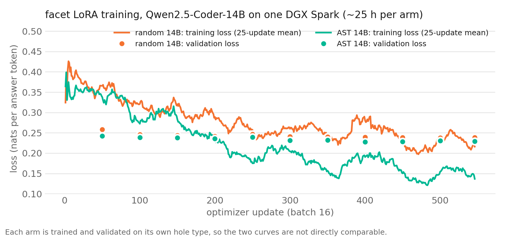
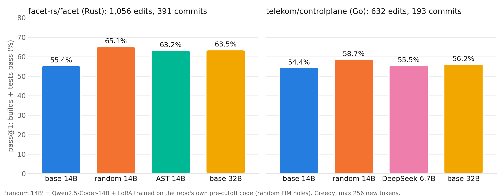
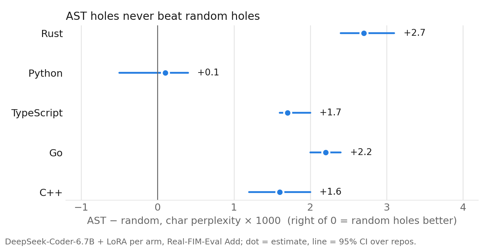
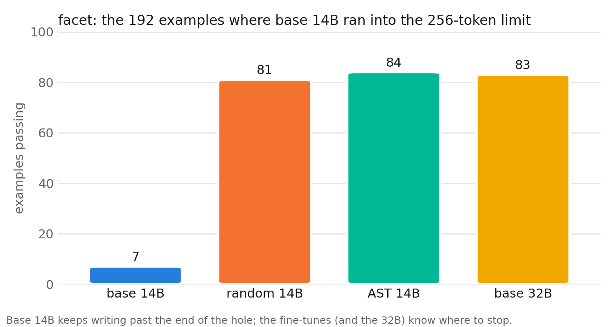
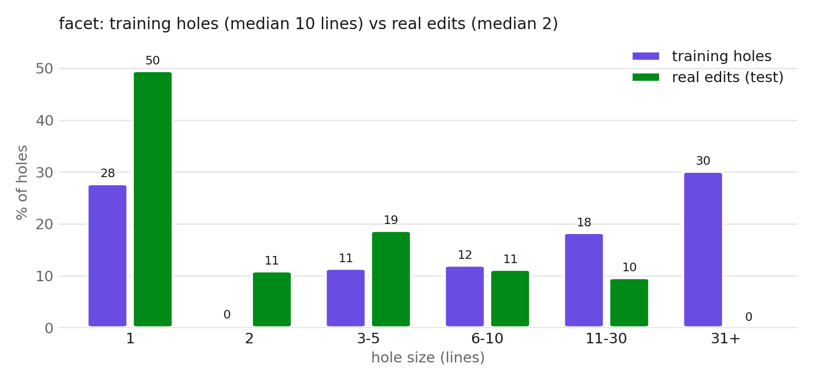

# Build your own Copilot, part 2: does it actually compile?

*Draft. Numbers are final; links marked `<…>` get filled in at release.*

Copilot, Cursor, Windsurf, Cline, Aider, the list goes on. Tab-completion that reads your mind is now just part of
writing code, and on popular open-source code it's uncanny. Then you open the codebase you actually work on: the
internal one, with its own macros, its own error types, its own way of doing everything. The suggestions get noticeably
dumber. Of course they do. The model has never seen this code.

A while back, [Build your own GitHub Copilot](https://prvn.sh/build-your-own-github-copilot) asked the obvious
question: what if you fine-tune an open model on your repo? It got a 47% jump in exact match on a Svelte codebase from
a partly trained Qwen2.5-Coder-14B. It also said, quite rightly, that the best way to evaluate a code model is to
**build the code and run the tests**, and that exact match and BLEU were the practical stand-ins. This post is me
doing the expensive version, on purpose.

> 💡 Same caveat as before: this is about **tab autocomplete** (fill-in-the-middle), not chat agents. The model sees
> the code before and after your cursor and fills in the gap.

## The plan

1. Pick a model small enough to fine-tune and serve on one box.
2. Pick repos that have real tests and a public history I can split by date.
3. Train only on the repo **as it was on a cutoff date**.
4. Test only on code the team wrote **after** that date, so nothing in the test set could have been memorised.
5. Score each completion by splicing it into the file and running `cargo build` + `cargo test` (or the Go equivalents).
6. On the side, settle an argument: do syntax-aware (AST) training holes beat plain random ones?

### I. Choosing a model

**Qwen2.5-Coder-14B**, the same family as the original post. It has a proper FIM format (`<|fim_prefix|>`,
`<|fim_suffix|>`, `<|fim_middle|>`), an Apache-2.0 licence, and a 32B big brother to measure against. If a fine-tuned
14B can't keep up with an untuned 32B, the whole exercise is mostly academic.

The AST-vs-random question I first ran across five languages on **DeepSeek-Coder-6.7B**, because that's cheaper.

### II. The code

Two repos, picked for strong test suites and enough history on both sides of a cutoff:

| repo | language | cutoff | trained on | test edits (build+test-checkable) |
|---|---|---|---|---|
| [facet-rs/facet](https://github.com/facet-rs/facet) | Rust | 2026-01-01 | 8,735 FIM pairs from the snapshot | 1,056 from 391 commits |
| [telekom/controlplane](https://github.com/telekom/controlplane) | Go | 2026-05-01 | 2,833 FIM pairs | 632 from 193 commits |

They're public, but they stand in for "your internal repo". Everything after the cutoff is new to the fine-tune.

### III. The FIM task: where do you cut the holes?

A training example is a file with a hole cut out. The model gets the prefix and the suffix and has to write the
middle. The interesting design choice is *where the holes go*:

- **AST holes.** Parse the file with tree-sitter and cut out exactly one node: a function body, a match arm, an
  `impl` block. The original post did a version of this (masking "critical" nodes) and it sounds clearly right.
  Holes line up with how code is structured.
- **Random holes.** A span at a random position, with a length matched one-to-one to an AST hole in the same file.

So I built both, paired: same files, same hole lengths, same number of pairs, same seed, same everything. The only
difference is where the cut falls.

### IV. Training on the Spark

Everything ran on a single **NVIDIA DGX Spark** (GB10, 128 GB of unified memory). The recipe is deliberately boring:

- LoRA r=16, alpha 32, on all attention and MLP projections (68.8M trainable parameters);
- lr 1e-4 cosine, 1 epoch, batch 16, seed 42, plain bf16, no quantization.

The facet runs took **~25 hours per arm** (546 updates at ~163 s each), peaking at 37.5 GB.

Along the way the machine taught me something about unified memory. CPU and GPU share one 128 GB pool. The vLLM
server I use for daily coding reserves its slice up front and spikes ~30 GB more while loading weights. Running it
next to a 14B training run got the training run OOM-killed twice, along with my whole desktop session: once from a
heavy batch, once from restarting the server mid-run. Start the server first, then train.

### V. The eval: a time split, and the compiler as judge

This is the part I care most about.

**The test set comes from the future.** For every commit after the cutoff I take each block of 1–30 added lines in a
non-generated source file. The hole is the added block; the prefix and suffix are the rest of the file at that
commit. Real-FIM-Eval does the same with GitHub history. The filters:

- author and committer dates after the cutoff, and not an ancestor of the cutoff commit, which catches rebased and
  back-dated work;
- at most 5 examples per commit, so one giant refactor can't dominate.

**Then the compiler decides which examples are fair game.** At each example's commit, I build and test the real
file. Then I delete the hole and build and test again. An example only counts for pass@1 if:

1. the real code builds and passes the crate's tests, and
2. removing it breaks the build or the tests.

That second check matters. Otherwise "pass@1" is inflated by holes whose content the tests never look at.

**Scoring:**
- greedy completion, max 256 new tokens, spliced in, then `cargo build --all-targets` + `cargo test` for that crate;
- exact match as a secondary score;
- character-level perplexity of the real code;
- bootstrap confidence intervals that resample **commits**, because examples from one commit aren't independent.

A model "beats" another only if the whole 95% interval is above zero. Otherwise it "matches".

### VI. Results

**facet (Rust)**, 1,056 edits:

| | base 14B | **14B + LoRA (random holes)** | 14B + LoRA (AST holes) | base 32B |
|---|---|---|---|---|
| pass@1 | 55.4% | **65.1%** | 63.2% | 63.5% |
| exact match | 35.1% | **41.9%** | 40.8% | 39.7% |

- The random-hole fine-tune is **+9.8 points** over its own base (CI +7.2 to +12.3).
- It **matches** the untuned 32B: +1.6, CI −0.9 to +4.3. That's a model less than half the size, taking about a
  third less time per completion.

**controlplane (Go)**, 632 edits:
- fine-tune **58.7%** vs base 14B 54.4%: +4.3, CI +1.8 to +6.8;
- it also matches the 32B (56.2%) and DeepSeek-Coder-6.7B (55.5%).

A smaller gain on a smaller repo with a third as much training data, but the same direction.

Not too shabby for a day of training on a desktop-sized box!

## What didn't work

### AST holes

I really expected AST holes to win. They didn't, anywhere:

- **Five languages** (DeepSeek-6.7B, Real-FIM-Eval, perplexity): random holes were significantly better in Rust,
  TypeScript, Go and C++, and tied in Python.
- **facet** (pass@1 with the compiler as judge): AST was 2.0 points behind random overall and 2.5 behind on source
  files. The source-files gap is significant.

### Most of the gain is the model learning to stop

The base model's biggest failure isn't writing wrong code. It's **not stopping**. It fills the hole, then keeps
going and rewrites half of the suffix, and the file no longer compiles.

On the 192 facet examples where base 14B hit the 256-token limit:

| model | passes (of 192) |
|---|---|
| base 14B | 7 |
| AST fine-tune | 84 |
| random fine-tune | 81 |
| base 32B | 83 |

Both fine-tunes learned exactly what the bigger model already knows: where the hole ends.

Take those examples out and the picture is sharper:
- the **random** fine-tune still gains +3.8 points (CI +1.4 to +6.2);
- the **AST** fine-tune gains nothing (+0.5, CI −2.1 to +2.9);
- the AST adapter's perplexity on the real code is actually slightly *worse* than base.

So AST training taught the model where to stop, and not much else. Random holes taught it a bit about facet itself.

### Why AST lost: the holes were the wrong shape

This chart explains it:

- Real edits are small: median **2 lines**, half of them a single line.
- The AST holes I trained on have a median of **10 lines**, and 30% are longer than 30 lines.

"Pick a syntax node, weighted by size" produces a lot of whole functions and `impl` blocks, which is not what people
type. Random holes of the same lengths at least land in the middle of things, which looks more like a real edit.

### Smaller things

- The **controlplane** gain is mostly the stop effect too. With limit hits excluded, it's +1.7 and not significant.
- Exact match only partly follows pass@1. On facet test files, AST wins on exact match but not significantly. Exact
  match is a useful sanity check, but I wouldn't pick a model on it.
- One seed per arm and two repos. The direction is consistent, but treat the exact numbers as estimates.

## Conclusion and future work

Fine-tuning a 14B code model on your own repo's history is worth it: about +10 points of "does it still compile and
pass the tests" on facet, enough to match a model twice the size. It takes one machine and about a day, and no
hand-labelled data at all. Just use random holes.

Things I'd try next:

- **Train on real edits instead of synthetic holes.** facet's own pre-cutoff history has ~35,000 real added blocks
  (8,898 at most 10 per commit, roughly the same size as the training set used here). Their size distribution matches
  the test set almost exactly: 61% single-line vs 50% in the test set.
- **Cross-file context.** Every model here saw only the current file. Retrieving related definitions from the repo
  should stack with fine-tuning.
- **Keeping it fresh.** A fine-tune is a snapshot. How fast does the gain decay as the repo moves on, and how cheap is
  a weekly top-up?
- **Serving it.** A LoRA on top of Qwen2.5-Coder-14B in vLLM, wired into the editor, measured on real latency.

Stay tuned!

### Links

- Code, configs, eval harness, every summary and training log: `<GITHUB_REPO_URL>`
- Adapters: `<HF_URL_RANDOM>` (recommended) and `<HF_URL_AST>`
- The post that started it: [Build your own GitHub Copilot](https://prvn.sh/build-your-own-github-copilot)
- Benchmark used for the five-language run: [Real-FIM-Eval](https://huggingface.co/datasets/gonglinyuan/real_fim_eval)
